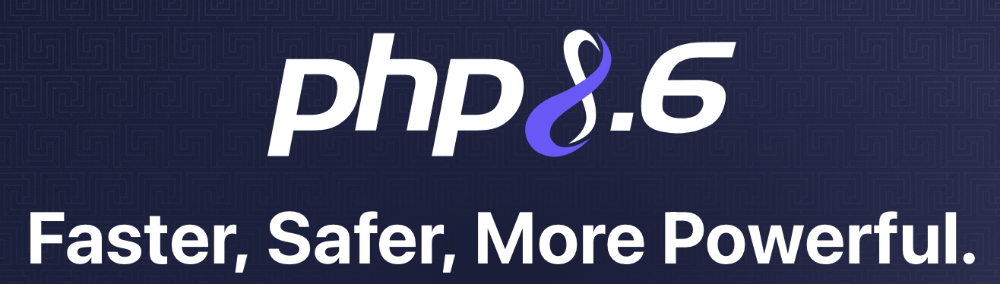

# PHP 8.6 - PHP Bergen

* [PHP 8.6 index](docs/index.md)
* December activity: Christmas beer.

## References

* [This presentation on Github](https://github.com/PHP-Bergen/php_8)
* The slides are located in `/docs`.
* The code is located in `/src`.
* PHP Bergen git repos can be found at https://github.com/PHP-Bergen
* PHP Bergen home page: https://phpbergen.no
* [Future planning](https://github.com/orgs/PHP-Bergen/projects/1)
